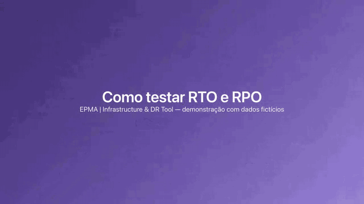

# EPMA | Infrastructure & DR Tool

Console web (Node.js, **zero dependências npm**) para exercícios de **RTO/RPO** em clusters Kubernetes/EKS e recursos AWS (EC2, RDS/Aurora, ElastiCache):

- **Criar o ambiente com um wizard** que descobre automaticamente clusters, instâncias, bancos e workloads (somente leitura);
- **Ligar/desligar** o cluster EKS (escala de capacidade), os workloads de um Kubernetes local (Docker Desktop/kind) e/ou **EC2, RDS e ElastiCache**, com confirmação e histórico;
- **Testar aplicações** (HTTP, TCP, recurso Kubernetes, comando) de forma pontual e contínua;
- **Executar exercícios de DR** que derrubam o ambiente, medem o tempo até a recuperação e a perda de dados;
- **Gerar relatórios** (HTML imprimível/PDF, Markdown, CSV, JSON e consolidado com tendência).

> [!WARNING]
> **Esta ferramenta liga, desliga e — no ElastiCache — EXCLUI recursos reais.** Leia antes de usar em produção:
>
> - Os fluxos de **EKS, EC2, RDS e ElastiCache foram validados apenas com `aws`/`kubectl` simulados** (77 testes automatizados) e contra um Kubernetes local; **não foram exercitados contra uma conta AWS real**. Comece por um ambiente **descartável** e use o ambiente simulado para treinar.
> - O **ElastiCache não tem stop/start**: "desligar" exclui o recurso (com snapshot final) e "ligar" o recria a partir do snapshot — o endpoint pode mudar e os dados gravados depois do snapshot se perdem. A restauração de cache **Serverless** por snapshot não foi confirmada contra a AWS real.
> - Rode exercícios em **janelas planejadas**; as operações destrutivas exigem confirmação pelo nome do ambiente.
> - Software fornecido **"como está", sem garantias** (licença [MIT](LICENSE)). Você é responsável pelo que executar na sua infraestrutura.

## Requisitos

| Item | Observação |
|---|---|
| Node.js **26** (LTS) | `.nvmrc` incluso (`nvm use`) |
| `aws` CLI v2 | credenciais/perfil já configurados (`aws sso login`, variáveis, etc.); usado para EKS, EC2, RDS e ElastiCache |
| `kubectl` | opcional, mas necessário para o provider `k8s` (Docker Desktop/kind), para testes `k8s` e para confirmar nós Ready no EKS |
| `docker` | opcional: usado só pela descoberta do wizard (lista containers, ex.: um Redis local para o canário de RPO) |

Nada disso é necessário para o **ambiente de demonstração** (simulado).

## Como rodar

```bash
npm start            # http://127.0.0.1:3001
npm test             # testes (node:test)
npm run dev          # recarrega ao editar
```

| Variável | Padrão | Descrição |
|---|---|---|
| `PORT` | `3001` | Porta HTTP |
| `HOST` | `127.0.0.1` | Interface. Qualquer valor não-loopback **exige** `ADMIN_TOKEN` |
| `DATA_DIR` | `./data` | Onde ficam ambientes, snapshots, execuções e kubeconfigs |
| `ADMIN_TOKEN` | — | Token (≥16 caracteres) exigido em todas as chamadas `/api` (`Authorization: Bearer`) |
| `ALLOWED_HOSTS` | — | Hostnames extras aceitos no cabeçalho `Host` (lista separada por vírgula) |
| `ALLOW_NO_AUTH` | — | `true` permite escutar fora do localhost **sem** token (opt-in; risco: quem alcança a porta controla o console). Veja `compose.noauth.yaml` |

Na primeira execução é criado o **ambiente de demonstração (simulado)**: um cluster fictício com testes apontando
para endpoints locais `/demo/...` que reagem ao liga/desliga. Dá para rodar um exercício completo sem tocar na AWS.

## Guia ilustrado de testes

Passo a passo com imagens e um vídeo mostrando um exercício completo de RTO/RPO: **[docs/guia-de-testes.md](docs/guia-de-testes.md)**.

### Vídeo de demonstração (60 s, sem áudio)

Painel → testes → exercício ao vivo (falha, recuperação, medição de RPO) → relatório aberto automaticamente.

[](docs/video/demo-60s.mp4)

▶ **[Assistir o vídeo completo (MP4, 1280×720)](docs/video/demo-60s.mp4)** — o GIF acima é só uma prévia.

> Todos os dados do guia e do vídeo são **fictícios** (ambiente simulado "Acme Pagamentos — Produção (fictício)").

## Instalar (npm)

Requer Node ≥ 26. Há duas formas; a primeira **não precisa de token**.

**1) Direto do repositório (sem conta nem token)** — fixe uma versão (tag):

```bash
npm install -g github:1985epma/infrastructure-drtool#v1.1.1
epma-drtool --help
epma-drtool            # http://127.0.0.1:3001 — dados em ./data (pasta onde o comando é executado)

# sem instalar:
npx github:1985epma/infrastructure-drtool#v1.1.1
```

**2) Pelo GitHub Packages** (`@1985epma/infrastructure-drtool`, publicado pelo workflow `.github/workflows/publish.yml` a cada Release).
O registro npm do GitHub **exige autenticação para instalar, mesmo sendo um pacote público**: use um token pessoal (classic)
de qualquer conta, com o escopo `read:packages`:

```bash
# ~/.npmrc (uma vez)
@1985epma:registry=https://npm.pkg.github.com
//npm.pkg.github.com/:_authToken=SEU_TOKEN_COM_read:packages

npm install -g @1985epma/infrastructure-drtool
```

## Docker (imagem endurecida)

O `Dockerfile` gera uma imagem mínima e endurecida (Node 26 + Alpine, base fixada por digest):

```bash
docker build -t infrastructure-drtool .                                  # completa: inclui aws CLI e kubectl (~600 MB)
docker build --build-arg WITH_TOOLS=false -t infrastructure-drtool:slim .  # sem aws/kubectl (~260 MB)
docker build --build-arg RUN_TESTS=true -t infrastructure-drtool .       # roda os 77 testes durante o build

docker run -d --name drtool -p 127.0.0.1:3001:3001 \
  --read-only --tmpfs /tmp:rw,noexec,nosuid,size=16m \
  --cap-drop ALL --security-opt no-new-privileges:true --pids-limit 256 --memory 512m \
  -e ADMIN_TOKEN="$(openssl rand -hex 24)" -v drtool-data:/data \
  infrastructure-drtool
```

Ou, com Docker secrets e as mesmas restrições, `docker compose up -d --build` (veja o `compose.yaml`):

```bash
mkdir -p secrets && openssl rand -hex 24 > secrets/admin_token.txt   # token (≥ 16 caracteres)
docker compose up -d --build                                          # token obrigatório (padrão)
BIND_ADDR=10.0.0.5 ALLOWED_HOSTS=10.0.0.5 docker compose up -d        # rede interna (IP específico, não 0.0.0.0)
```

> [!CAUTION]
> **A autenticação é o padrão e só se desliga por opt-in explícito.** O console executa comandos e liga/desliga infraestrutura:
> quem alcança a porta sem token controla tudo. Para uso interno em rede isolada e confiável, o `compose.noauth.yaml`
> (`docker compose -f compose.yaml -f compose.noauth.yaml up -d`, Compose ≥ 2.24) define `ALLOW_NO_AUTH=true` e remove o secret.

**O que a imagem faz para reduzir superfície:**

- multi-stage (sem testes nem ferramentas de build na imagem final) e **sem dependências npm** (só a stdlib do Node);
- `npm`, `npx`, `corepack`, `yarn` e o `apk` removidos; bits setuid/setgid zerados;
- usuário **não-root** (uid 10001, sem shell de login), `tini` como PID 1;
- código em `/app` somente leitura; o único diretório gravável é `/data` (volume);
- **Node Permission Model** (`--permission`): o processo só lê `/app`, `/data` e `/run/secrets`, só grava em `/data` e não carrega addons nativos/WASI/workers. (`--allow-child-process` e `--allow-net` são necessários para executar `aws`/`kubectl` e para escutar/testar rede);
- escuta em `0.0.0.0` mas **recusa iniciar sem token**: `ADMIN_TOKEN` ou `ADMIN_TOKEN_FILE` (ex.: Docker secret em `/run/secrets/admin_token`);
- `HEALTHCHECK` na UI estática (não depende de `curl`); nenhum segredo nas camadas.

**Verificado em execução:** sem token o container recusa subir; com `--read-only`, `--cap-drop ALL` e `no-new-privileges` a UI responde, a API devolve 401 sem token, `CapEff` é zero, escrita em `/app` e `/etc` falha, e um exercício completo (ambiente simulado) gera o relatório em `/data`.

**Limitações:**

- o `docker-cli` **não** é instalado de propósito (usá-lo exigiria montar `/var/run/docker.sock`, o que equivale a root no host); por isso, dentro do container, recursos que dependem do Docker do host (listar containers no wizard, canário via `docker exec`) não funcionam;
- credenciais AWS: prefira variáveis `AWS_*`, role/IRSA ou monte `~/.aws` (somente leitura);
- para `kubectl`/Kubernetes local, monte o kubeconfig e lembre que `127.0.0.1` dentro do container não é o host (Docker Desktop: use `host.docker.internal` no `server:` do kubeconfig);
- para receber correções de segurança, atualize o digest da base (`ARG NODE_IMAGE`) e reconstrua; um scan como `trivy image infrastructure-drtool` é recomendado no CI.

## Providers

Cada ambiente tem uma **base de computação** (provider). Recursos AWS (EC2/RDS/ElastiCache) podem ser anexados a qualquer
provider, exceto ao simulado.

| Provider | Para que serve | Liga/desliga |
|---|---|---|
| `eks` | Amazon EKS com *managed node groups* | zera/restaura os node groups (seção abaixo) |
| `k8s` | Kubernetes via `kubectl` — **Docker Desktop**, kind, minikube ou qualquer contexto | zera/restaura as réplicas dos Deployments/StatefulSets escolhidos |
| `custom` | Fargate, Karpenter, self-managed, Terraform, scripts… | executa os comandos que você informar (sem shell) |
| `aws` | Somente recursos AWS (EC2, RDS, ElastiCache), sem cluster Kubernetes | opera os recursos configurados |
| `simulated` | Demonstração, sem AWS | simulado em memória |

## Wizard de novo ambiente

Em **Ambientes → + Novo ambiente** abre um wizard em etapas que **descobre os recursos** e monta a configuração.
Há também o link **Configurar manualmente**, que leva ao formulário completo (o mesmo usado para editar ambientes existentes).

Etapas (as que não se aplicam à sua escolha são puladas):

1. **Básico** — nome, descrição, **base de computação** (Kubernetes local/Docker Desktop → `k8s`; Amazon EKS → `eks`; somente
   recursos AWS → `aws`) e complementos AWS (EC2, RDS, ElastiCache).
2. **Conta AWS** — perfil e região, com botão **Validar credenciais** (mostra conta e ARN).
3. **Cluster** — EKS: clusters e node groups descobertos; Docker Desktop/kind: contextos do `kubectl` (pré-seleciona `docker-desktop`)
   e a tabela de workloads para marcar quais serão ligados/desligados.
4. **EC2**, 5. **RDS/Aurora**, 6. **ElastiCache** — tabelas com checkbox; itens que a ferramenta não consegue operar aparecem
   desabilitados com o motivo (Spot, Auto Scaling, réplica de leitura, membro de cluster Aurora, AUTH token, Global Datastore, Memcached).
   No ElastiCache é preciso marcar o aceite de que o cache será **excluído e recriado** (`acknowledgeDelete`).
7. **Testes de aplicação** — sugestões editáveis geradas a partir do que foi escolhido (teste `k8s` por workload, `tcp` para o
   endpoint de cada RDS) mais uma URL HTTP de saúde opcional; é preciso ao menos um teste crítico.
8. **RPO e metas** — método de RPO (canário no Redis detectado no Docker, canário em ConfigMap, `LatestRestorableTime` do RDS ou não medir),
   metas de RTO/RPO e padrões do exercício.
9. **Revisão** — resumo e **Criar ambiente**; o novo ambiente é selecionado em seguida.

O que é descoberto, por escolha:

| Escolha | Descoberta (somente leitura) |
|---|---|
| Docker Desktop / kind | contextos do `kubectl`, Deployments e StatefulSets de todos os namespaces, containers Docker (para sugerir o canário de RPO) |
| EKS | perfis AWS, validação de credenciais, clusters e seus node groups (estado e escala) |
| EC2 | instâncias (nome, estado, tipo, IPs; marca Spot e membros de Auto Scaling como não suportadas) |
| RDS / Aurora | instâncias e clusters (engine, status, endpoint/porta; marca réplicas e membros Aurora) |
| ElastiCache | replication groups e caches Serverless (marca AUTH token, Global Datastore, Memcached) |

A descoberta **nunca altera nada** — só lê (veja a [API de descoberta](#api-de-descoberta-somente-leitura)). Criar o ambiente
só grava a configuração em `data/`. **Se a descoberta falhar** (sem credenciais, SSO expirado, `kubectl`/`docker` ausente), a etapa
mostra a mensagem do erro, permite tentar de novo e permite **digitar os valores manualmente**. Para credenciais AWS
expiradas rode, por exemplo, `aws sso login --profile meu-perfil` e tente de novo.

## Como funciona o liga/desliga no EKS

O plano de controle do EKS **não pode ser desligado**; o que se desliga é a capacidade de computação.

- **Desligar**: lê os *managed node groups*, **salva a escala original** (min/desired/max) em `data/state/<ambiente>.json`
  e aplica `minSize=0, desiredSize=0` (`maxSize` mantido, mínimo 1) via `aws eks update-nodegroup-config`. Aguarda os grupos
  ficarem `ACTIVE` em zero e (se kubectl) os nós saírem do cluster.
- **Ligar**: restaura a escala salva (ou `fallbackDesired` se não houver snapshot), aguarda `ACTIVE` e os nós **Ready**.
  Um segundo "desligar" nunca sobrescreve o snapshot com zeros.
- Opcional `scaleWorkloads`: antes de remover os nós, escala Deployments/StatefulSets dos namespaces informados para 0 e restaura depois.
- O kubeconfig usado é gerado em `data/kubeconfig/` (não altera `~/.kube/config`).

### Limitações → provider "Comandos customizados"

Clusters com **Fargate, Karpenter ou node groups self-managed** não são cobertos pelo provider EKS. Use o provider
customizado, que executa seus comandos **sem shell** (argv) e transmite a saída ao console:

```text
Status (opcional): ./scripts/status.sh        # última linha: running | stopped | partial | transitioning
Desligar:          terraform -chdir=infra apply -auto-approve -var node_count=0
Ligar:             terraform -chdir=infra apply -auto-approve -var node_count=3
```

```text
Desligar:          eksctl scale nodegroup --cluster meu-cluster --name ng-apps --nodes 0 --nodes-min 0
Ligar:             eksctl scale nodegroup --cluster meu-cluster --name ng-apps --nodes 3 --nodes-min 1
```

Como não há shell, **caminhos com espaço precisam de aspas** (`"/meu caminho/script.sh" stop`).

**Cluster local (docker-desktop, kind):** prefira o provider nativo `k8s` (próxima seção). O script
`scripts/local-k8s.sh status|stop|start` é um exemplo equivalente em shell para o provider `custom`: zera e restaura as
réplicas de deployments listados (padrão: CoreDNS e local-path-provisioner; ajuste com `KUBE_CONTEXT` e `WORKLOADS`).

## Provider `k8s`: Kubernetes via kubectl (Docker Desktop, kind, minikube)

O nó de um cluster local pertence à ferramenta que o gerencia (Docker Desktop, kind…); pará-lo na mão pode quebrá-la. Por
isso este provider opera **por workload**:

- **Desligar**: lê as réplicas dos Deployments/StatefulSets escolhidos, **grava a escala original** em
  `data/state/<ambiente>.json` (chave `namespace/tipo/nome`) e executa `kubectl scale --replicas=0`; aguarda todas as
  réplicas encerrarem (`status.replicas` = 0). Um segundo "desligar" nunca sobrescreve a escala salva com zero.
- **Ligar**: restaura as réplicas salvas (se não houver registro de um workload, usa **1 réplica** e avisa) e aguarda
  `readyReplicas` ≥ desejado em todos.
- **Estado**: *Desligado* (todos em 0), *Ligado* (todos prontos), *Em transição* (há réplicas desejadas ainda não prontas),
  *Parcial* ou *Erro* (workload inexistente ou cluster inacessível). O painel lista os workloads com desejado/prontas.
- Os testes `k8s` do ambiente usam o mesmo contexto (e `kubeconfig`, se informado).
- Limites de espera: `k8s.timeoutSec` (padrão 300 s, entre 30 e 3600).
- Atenção: um **HPA** (ou outro controlador que reescale) pode recriar réplicas depois de zeradas; ajuste/pause-o ou deixe o
  workload fora da seleção.

Configuração do ambiente (JSON em `data/environments.json`; `workloads` também aceita strings `namespace/tipo/nome`; o tipo é
`deployment` ou `statefulset`):

```json
{
  "name": "Kubernetes local (docker-desktop)",
  "provider": "k8s",
  "k8s": {
    "context": "docker-desktop",
    "kubeconfig": "",
    "timeoutSec": 300,
    "workloads": [
      { "namespace": "kube-system", "kind": "deployment", "name": "coredns" },
      { "namespace": "local-path-storage", "kind": "deployment", "name": "local-path-provisioner" }
    ]
  },
  "targets": { "rtoSeconds": 120, "rpoSeconds": 60 },
  "checks": [
    { "name": "CoreDNS", "type": "k8s", "kind": "deployment", "namespace": "kube-system", "resource": "coredns", "critical": true }
  ]
}
```

`context` é obrigatório e é preciso ao menos um workload (até 200). Pode ser combinado com os recursos AWS da seção seguinte.

## Recursos AWS: EC2, RDS e ElastiCache

Além (ou no lugar) do cluster Kubernetes, um ambiente pode controlar instâncias **EC2**, bancos **RDS/Aurora** e caches
**ElastiCache**.

- **Provider `aws`** ("Recursos AWS (EC2/RDS/ElastiCache)"): ambiente só com esses recursos, sem cluster Kubernetes.
  Exige ao menos um recurso configurado.
- **Anexar a `eks` ou `custom`**: o bloco "Recursos AWS" do ambiente vale para qualquer provider, exceto o simulado
  (que ignora recursos). O provider base continua fazendo o que já fazia e os recursos são operados junto.
- Configuração (`resources`): `region` e `profile` (se vazios, usa os do EKS; **a região é obrigatória** quando há
  recursos e o provider não é EKS), `timeoutSec` de espera por recurso (padrão 3600), e as listas:
  - `ec2.instanceIds` (`i-…`) e/ou um seletor por tag (`ec2.tagKey` + `ec2.tagValue`);
  - `rds.instances` e `rds.clusters` (Aurora e Multi-AZ DB clusters);
  - `elasticache.replicationGroups` e `elasticache.serverlessCaches`.

### O que "desligar" e "ligar" fazem na prática

| Recurso | Desligar | Ligar | Atenção |
|---|---|---|---|
| **EC2** | `stop-instances` nas instâncias em execução; aguarda `stopped` | `start-instances` nas paradas; aguarda `running` | **Spot** e instâncias de **Auto Scaling Group** são **ignoradas** (com aviso): o ASG as substituiria. Discos *instance store* perdem os dados ao parar. O IP público muda ao religar, a menos que use Elastic IP. |
| **RDS (instância)** | `stop-db-instance`; aguarda `stopped` | `start-db-instance`; aguarda `available` | A AWS **religa sozinha após 7 dias parado**. **Réplicas de leitura** não podem parar e são ignoradas; **SQL Server Multi-AZ** não suporta parar (a API recusa e o erro aparece no console). **Membros Aurora** são ignorados: configure o **cluster**. |
| **RDS / Aurora (cluster)** | `stop-db-cluster`; aguarda `stopped` | `start-db-cluster`; aguarda `available` | Mesma regra dos 7 dias. Tempos de parada/início são de minutos. |
| **ElastiCache — replication group** (Redis/Valkey) | **Não existe stop/start.** Captura a configuração, grava-a em disco e **EXCLUI** o grupo com **snapshot final** (`<id>-epma-<data>`); aguarda a exclusão e o snapshot ficar `available` | **Recria** o grupo a partir desse snapshot com a configuração capturada; aguarda `available` | Dados preservados **só até o snapshot final**. O **endpoint pode mudar** (o console avisa; considere um CNAME no Route 53). O snapshot **fica retido** após religar e gera custo: exclua-o manualmente quando não precisar. |
| **ElastiCache — Serverless** | Mesmo princípio: `delete-serverless-cache` com `--final-snapshot-name` | `create-serverless-cache` com `--snapshot-arns-to-restore` apontando para o snapshot | Valem os avisos acima. A restauração Serverless **não foi validada contra a AWS real**: só foi exercitada nos testes automatizados com um `aws` falso. |

**ElastiCache — o que NÃO é suportado** (o console recusa antes de excluir qualquer coisa, ou nem encontra o recurso):
replication groups com **AUTH token** (não é recuperável ao recriar), membros de **Global Datastore**, **Memcached**
(inclusive Serverless: não há snapshot) e clusters *standalone* sem replication group (cache clusters avulsos).
A configuração recriada cobre engine/versão, tipo de nó, shards/réplicas, failover e Multi-AZ, subnet group,
security groups, parameter group, porta, criptografia (trânsito/repouso/KMS), janelas e retenção de snapshot,
user groups e tags. Outras opções (ex.: entrega de logs, notificações SNS) **não são capturadas** e voltam ao padrão.

> O suporte a EC2/RDS/ElastiCache **não foi exercitado contra a AWS real**: os nomes de parâmetros do `aws` CLI foram
> conferidos na ajuda offline do CLI e o fluxo é coberto por testes automatizados com um `aws` falso. Faça o primeiro
> teste em um ambiente descartável.

### Ordem e conjunto

- **Desligar**: aplicação primeiro, depois dados — provider base (Kubernetes/comandos) → EC2 → **RDS ‖ ElastiCache** (em paralelo).
- **Ligar**: ordem inversa — **RDS ‖ ElastiCache** (em paralelo) → EC2 → provider base.
- O conjunto configurado é tratado **como um todo**: "desligar" para o que está ligado e "ligar" liga o que está parado.
  Isso inclui instâncias que já estavam paradas de propósito dentro do conjunto.
- O estado do ambiente é a combinação dos recursos (itens ignorados não contam); recurso com erro ou "não encontrado e sem snapshot" deixa o estado em **Erro**.
  Se uma etapa falhar, as demais da mesma camada terminam e o erro agregado é exibido.

### Travas de segurança

- **`elasticache.acknowledgeDelete`**: obrigatório (a validação recusa salvar sem ele) sempre que houver ElastiCache listado.
  Marca que você entende que o cache será **excluído e recriado**, não apenas parado.
- **Confirmação pelo nome do ambiente**: desligar e iniciar exercício em ambientes reais exigem digitar o nome (validado também no servidor).
- A configuração e o nome do snapshot são gravados em `data/state/<ambiente>.json` **antes** da exclusão; sem esse registro
  não há como recriar. Não apague essa pasta enquanto houver ElastiCache desligado.

### Impacto em RTO e RPO

- **RPO**: o ElastiCache é restaurado do **snapshot final**, então dados até o instante do snapshot são preservados.
  Gravações feitas entre o snapshot e a exclusão, ou perdidas por o cache ficar inexistente enquanto está desligado,
  não voltam. Para medir de verdade, use uma fonte de RPO (seção abaixo) que leia um dado que passe pelo cache/banco.
  No RDS, a fonte `rds-instance`/`rds-cluster` lê `LatestRestorableTime`.
- **RTO**: inclui o tempo de religar cada recurso, em ordem de grandeza **minutos para RDS/Aurora e 10+ minutos para ElastiCache**
  (varia com tamanho, engine e região — o exercício mede o valor real). Como os dados sobem antes da aplicação, o tempo da camada de
  dados soma-se ao da camada de aplicação no relatório ("infraestrutura religando").

## API de descoberta (somente leitura)

Alimenta o wizard. Todos são `GET` sob `/api/discover/` (com `ADMIN_TOKEN`, exigem `Authorization: Bearer` como o resto da
`/api`). Executam apenas comandos de leitura, sem shell; `profile`, `region` e `context` são validados (inválido → **400**) e
falhas do `aws`/`kubectl`/`docker` voltam como **422** com a mensagem da ferramenta (para credenciais AWS, com dica de login).

| Endpoint | Parâmetros | Resposta (resumo) |
|---|---|---|
| `/tools` | — | `{aws, kubectl, docker}`, cada um `{ok, version}` |
| `/aws/profiles` | — | `{profiles:[{name, region}], defaultRegion}` (de `aws configure list-profiles`) |
| `/aws/identity` | `profile`, `region` | `{account, arn}` (`sts get-caller-identity`; só o perfil é usado) |
| `/eks` | `profile`, `region` | `{clusters:[{name, version, status, nodegroups:[{name, status, desired, min, max, instanceTypes}]}]}` (até 30 clusters) |
| `/ec2` | `profile`, `region` | `{instances:[{id, name, state, type, publicIp, privateIp, asg, spot, skip}]}` — estados `pending/running/stopping/stopped`; `skip` = motivo (Spot/Auto Scaling) ou `null` |
| `/rds` | `profile`, `region` | `{instances:[{id, engine, status, class, multiAz, endpoint, port, cluster, replica, skip}], clusters:[{id, engine, status, endpoint, port}]}` |
| `/elasticache` | `profile`, `region` | `{replicationGroups:[{id, status, engine, nodeType, skip}], serverless:[{id, status, engine, skip}], warnings:[]}` — se só uma das duas consultas falhar, devolve o resto com `warnings`; se ambas falharem, 422 |
| `/k8s/contexts` | — | `{current, contexts:[{name, dockerDesktop}]}` |
| `/k8s/workloads` | `context` (obrigatório) | `{workloads:[{namespace, kind, name, replicas, ready}]}` — Deployments e StatefulSets de todos os namespaces |
| `/docker/containers` | — | `{containers:[{name, image, status, state, ports, kind}]}` — `kind` = `redis`, `postgres`, `mysql` ou `other` (pela imagem) |

Exemplo:

```bash
curl -s "http://127.0.0.1:3001/api/discover/k8s/workloads?context=docker-desktop"
# {"workloads":[{"namespace":"kube-system","kind":"deployment","name":"coredns","replicas":2,"ready":2}, ...]}
```

Permissões IAM **de leitura** para a descoberta (as de operação estão na seção seguinte):

| Endpoint | Ações |
|---|---|
| `/eks` | `eks:ListClusters`, `eks:DescribeCluster`, `eks:ListNodegroups`, `eks:DescribeNodegroup` |
| `/ec2` | `ec2:DescribeInstances` |
| `/rds` | `rds:DescribeDBInstances`, `rds:DescribeDBClusters` |
| `/elasticache` | `elasticache:DescribeReplicationGroups`, `elasticache:DescribeServerlessCaches` |
| `/aws/identity` | `sts:GetCallerIdentity` (não exige permissão IAM; funciona com qualquer credencial válida) |

## Permissões IAM mínimas

> Para **operar** os recursos. A descoberta do wizard precisa só das ações de leitura listadas na seção anterior
> (inclua `eks:ListClusters`, que não está nos blocos abaixo, se for usar a descoberta de clusters EKS).

Cluster EKS (provider `eks`):

```json
{
  "Version": "2012-10-17",
  "Statement": [
    { "Effect": "Allow", "Action": ["eks:DescribeCluster", "eks:ListNodegroups", "eks:DescribeNodegroup", "eks:UpdateNodegroupConfig"], "Resource": "*" }
  ]
}
```

Recursos AWS — inclua apenas os serviços que o ambiente usa:

```json
{
  "Version": "2012-10-17",
  "Statement": [
    {
      "Sid": "Ec2",
      "Effect": "Allow",
      "Action": ["ec2:DescribeInstances", "ec2:StopInstances", "ec2:StartInstances"],
      "Resource": "*"
    },
    {
      "Sid": "Rds",
      "Effect": "Allow",
      "Action": [
        "rds:DescribeDBInstances", "rds:DescribeDBClusters",
        "rds:StopDBInstance", "rds:StartDBInstance",
        "rds:StopDBCluster", "rds:StartDBCluster"
      ],
      "Resource": "*"
    },
    {
      "Sid": "ElastiCache",
      "Effect": "Allow",
      "Action": [
        "elasticache:DescribeReplicationGroups", "elasticache:DescribeCacheClusters",
        "elasticache:DescribeSnapshots", "elasticache:ListTagsForResource",
        "elasticache:CreateSnapshot", "elasticache:DeleteReplicationGroup", "elasticache:CreateReplicationGroup",
        "elasticache:DescribeServerlessCaches", "elasticache:CreateServerlessCacheSnapshot",
        "elasticache:DeleteServerlessCache", "elasticache:CreateServerlessCache",
        "elasticache:AddTagsToResource"
      ],
      "Resource": "*"
    }
  ]
}
```

Notas:

- `iam:PassRole` **não** é necessário. As ações `rds:Describe*` também servem à fonte de RPO por RDS; as de ElastiCache só são
  usadas quando há ElastiCache no ambiente. Caches/snapshots criptografados com chave KMS própria podem exigir permissões
  adicionais de KMS para criar o snapshot e restaurá-lo.
- A seleção de EC2 por tag usa `ec2:DescribeInstances` com filtro; não é preciso `ec2:DescribeTags`.
- Para `kubectl` é preciso também mapear o principal IAM no cluster (access entries / aws-auth) com permissões de leitura
  (e `scale`, se usar `scaleWorkloads`).
- Restrinja `Resource` aos ARNs dos seus recursos em produção.

## Definições de RTO e RPO usadas

- **RTO** = instante em que o serviço voltou a passar nos **testes críticos** (primeira amostra de uma sequência de
  `stableProbes` amostras saudáveis consecutivas, após a indisponibilidade ser detectada) − instante em que a falha foi injetada.
  O relatório decompõe o RTO em: desligamento, acionamento (espera simulada da equipe, `holdDownSeconds`), infraestrutura religando e aplicações subindo.
  A resolução é o intervalo de amostragem (`probeIntervalSeconds`).
- **RPO** = instante da falha − timestamp do dado durável **mais antigo** entre "lido antes da falha" e "lido após a recuperação".
  Se o dado regrediu após a recuperação, houve perda real; se não, o RPO é a defasagem que já existia na falha.
  Com a fonte **canário**, o RPO é o último valor gravado com confirmação antes da falha menos o valor lido após a recuperação (nunca negativo).
  Sem fonte configurada, o RPO fica "não medido".
- **Veredito**: Aprovado (RTO ≤ meta e, se medido, RPO ≤ meta), Reprovado, ou Incompleto (cancelado/erro).
- Segurança do exercício: se algo falhar ou for cancelado depois da falha, o console executa uma **recuperação de segurança** para não deixar o ambiente desligado.

## Tipos de teste

| Tipo | Passa quando |
|---|---|
| `http` | status esperado (`200`, `200-299`, `200,204`), corpo contém texto (opcional), latência ≤ limite (opcional); TLS autoassinado opcional |
| `tcp` | conexão TCP estabelecida no prazo |
| `k8s` | Deployment/StatefulSet com todas as réplicas prontas (>0) ou DaemonSet totalmente pronto |
| `command` | código de saída 0 (executado sem shell) |

Testes **críticos** definem a disponibilidade do serviço. A URL aceita `{{origin}}` (endereço deste console).

## Fonte de RPO

Informe de onde ler o "dado durável mais recente":

- **canary** (canário de gravação) — o console executa `writeCommand` a cada `intervalSeconds` (padrão 2 s) com a variável
  `CANARY_VALUE` (ISO-8601 do instante) até a falha, e após a recuperação lê o valor com `readCommand`. O RPO é o dado
  **confirmado antes da falha que não voltou** (0 = nada perdido). Os comandos rodam sem shell: para expandir `$CANARY_VALUE`
  use `sh -c '…'`. Antes da falha são exigidas 3 gravações confirmadas. Exemplo com um Redis em container:
  `sh -c 'docker exec meu-redis redis-cli SET epma:canary "$CANARY_VALUE"'` e `docker exec meu-redis redis-cli GET epma:canary`;
- **http** — endpoint que devolve JSON com timestamp (`jsonPath`, ex.: `data.lastWriteAt`; ISO-8601 ou epoch s/ms);
- **command** — última linha da saída é um timestamp (ex.: `psql -At -c 'select max(created_at) from orders'`);
- **rds-instance / rds-cluster** — `LatestRestorableTime` (requer backups automáticos/PITR).

## Relatórios

Página **Relatórios**: HTML autônomo (resumo, linha do tempo, composição do RTO, disponibilidade por teste, RPO, recomendações; imprima para PDF),
Markdown, CSV das amostras, JSON bruto, observações editáveis e o **relatório consolidado** (evolução de RTO/RPO vs. metas). Também registra as operações manuais de ligar/desligar.

## Segurança

- Escuta apenas em `127.0.0.1`; `HOST` externo é recusado sem `ADMIN_TOKEN`.
- Validação do cabeçalho `Host` (anti DNS-rebinding) e de `Origin` em requisições que alteram estado; corpo só `application/json`.
- Desligar e iniciar exercício em ambientes reais exigem **digitar o nome do ambiente** (confirmação também validada no servidor).
- Os endpoints de descoberta (`/api/discover/*`) são `GET`, somente leitura, com parâmetros validados e sem shell.
- ElastiCache só pode ser configurado com `acknowledgeDelete` marcado (o recurso é excluído e recriado, não parado).
- Nenhum comando passa por shell; nomes de cluster/região/perfil são validados por regex; uma única operação por vez.
- Sem credenciais armazenadas: usa o perfil/variáveis AWS do processo. Relatórios escapam todo texto dinâmico; CSV neutraliza injeção de fórmulas.

## Estrutura

```text
server.js              entrada (variáveis de ambiente, guardas de segurança)
src/app.js             rotas da API, segurança, ciclo de vida
src/http.js            roteador, JSON, estáticos
src/providers/         eks.js · k8s.js (workloads via kubectl) · custom.js · sim.js (simulado)
                       aws-resources.js (EC2/RDS/ElastiCache) · with-resources.js (composição base + recursos)
src/discover.js        descoberta somente leitura (aws/kubectl/docker) usada pelo wizard
src/checks.js          testes http/tcp/k8s/command
src/rpo.js             leitura da fonte (inclui canário) e cálculo de RPO
src/drill.js           exercício e operações ligar/desligar
src/jobs.js            operação única em andamento (cancelável)
src/report.js          HTML, Markdown, CSV, consolidado
src/store.js           persistência JSON (data/)
scripts/local-k8s.sh   exemplo em shell de liga/desliga de workloads (provider custom)
public/                interface (JS puro, sem build)
  index.html · styles.css · theme-m3.css      estrutura + tema Google Material Design 3
  js/app.js · state.js · api.js · dom.js      shell, estado, cliente da API, helpers de DOM
  js/theme.js · theme-boot.js                 modo Auto/Claro/Escuro (persistido no navegador)
  js/wizard.js                                wizard de novo ambiente
  js/rpo-card.js                              cartão de configuração/teste da medição de RPO
  js/pages/                                   painel, testes, exercício, relatórios, ambientes
test/                  node --test (unitários, integração no ambiente simulado, canário, recursos AWS com `aws` falso)
```

## Licença

[MIT](LICENSE) © 2026 1985epma
