# Guia ilustrado: como fazer os testes de RTO/RPO

Este guia mostra, passo a passo, como medir **RTO** e **RPO** de uma infraestrutura com o
**EPMA | Infrastructure & DR Tool**: criar o ambiente, cadastrar os testes, configurar a medição de RPO,
rodar o exercício e ler o relatório.

> **Todos os dados deste guia são fictícios.** O ambiente "Acme Pagamentos — Produção (fictício)" é um ambiente
> **simulado**: nenhum recurso real foi ligado, desligado ou consultado.

[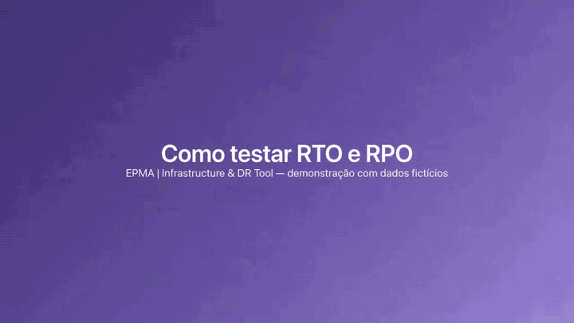](video/demo-60s.mp4)

▶ **Assista ao exercício completo em 60 segundos:** [`video/demo-60s.mp4`](video/demo-60s.mp4)

**Neste guia**

1. [O que o exercício mede](#1-o-que-o-exercício-mede)
2. [Antes de começar](#2-antes-de-começar)
3. [Passo a passo](#3-passo-a-passo)
4. [Como interpretar os resultados](#4-como-interpretar-os-resultados)
5. [Boas práticas e segurança](#5-boas-práticas-e-segurança)
6. [Solução de problemas](#6-solução-de-problemas)
7. [Regenerar as imagens e o vídeo](#7-regenerar-as-imagens-e-o-vídeo)

---

## 1. O que o exercício mede

| Sigla | Pergunta que responde | Como o console mede |
|---|---|---|
| **RTO** (*Recovery Time Objective*) | Quanto tempo o serviço fica fora do ar? | Da **injeção da falha** até o serviço voltar a passar nos **testes críticos**. |
| **RPO** (*Recovery Point Objective*) | Quanto dado se perde? | Pela **fonte de RPO** escolhida: o dado mais recente que sobreviveu comparado ao que existia na falha. |

Em um exercício o console faz tudo sozinho, nesta ordem:

```text
 baseline   FALHA        detecção     acionamento        recuperação        serviço         medição
 saudável   injetada     pelos        (espera que        (religa o          restaurado      de RPO
    │          │         testes       simula a decisão    ambiente)             │           (automática)
    │          │            │         da equipe)              │                  │               │
────●──────────●────────────●────────────────●────────────────●──────────────────●───────────────●────▶ tempo
               └─────────────────────────── RTO ──────────────────────────────────┘
                                                              └── recuperação ativa ┘
```

**Definições exatas usadas pelo código**

- **RTO** = instante em que o serviço voltou a passar nos testes críticos (primeira amostra de uma sequência de
  `stableProbes` amostras saudáveis seguidas, depois de a indisponibilidade ter sido detectada) **menos** o instante em
  que a falha foi injetada. A resolução é o intervalo entre testes.
- **Composição do RTO**: desligamento + acionamento (espera simulada da equipe) + infraestrutura religando +
  aplicações subindo. É aqui que se descobre o gargalo.
- **RPO** = instante da falha menos o dado durável **mais antigo** entre o lido *antes da falha* e o lido *depois da
  recuperação*. Com a fonte **canário**, é o último valor gravado com confirmação antes da falha menos o valor lido
  depois da recuperação (nunca negativo; **0 s = nada perdido**).
- **Veredito**: **Aprovado** (RTO dentro da meta e, se medido, RPO dentro da meta), **Reprovado** ou **Incompleto**
  (cancelado ou com erro antes de concluir).

No ambiente do guia as metas são **RTO 90 s** e **RPO 30 s**.

---

## 2. Antes de começar

| Item | Para quê |
|---|---|
| **Node.js 26** | rodar o console |
| `aws` CLI v2 | só se for testar EKS, EC2, RDS ou ElastiCache de verdade |
| `kubectl` | só para Kubernetes (Docker Desktop, kind, EKS) |
| `docker` | só na descoberta do wizard (listar containers, ex.: um Redis local) |

**Nada disso é necessário para treinar**: o *ambiente de demonstração (simulado)* é criado na primeira execução e
permite rodar o exercício completo sem tocar em nenhuma conta ou cluster.

**Subir o console**

```bash
npm start                      # http://127.0.0.1:3001
```

ou, em container endurecido (exige token):

```bash
docker run -d --name drtool -p 127.0.0.1:3001:3001 \
  --read-only --tmpfs /tmp:rw,noexec,nosuid,size=16m --cap-drop ALL \
  -e ADMIN_TOKEN="$(openssl rand -hex 24)" -v drtool-data:/data \
  infrastructure-drtool
```

Veja o [README](../README.md) para variáveis (`PORT`, `HOST`, `DATA_DIR`, `ADMIN_TOKEN`…) e para o `compose.yaml`.

---

## 3. Passo a passo

### Passo 1 — Conheça o Painel

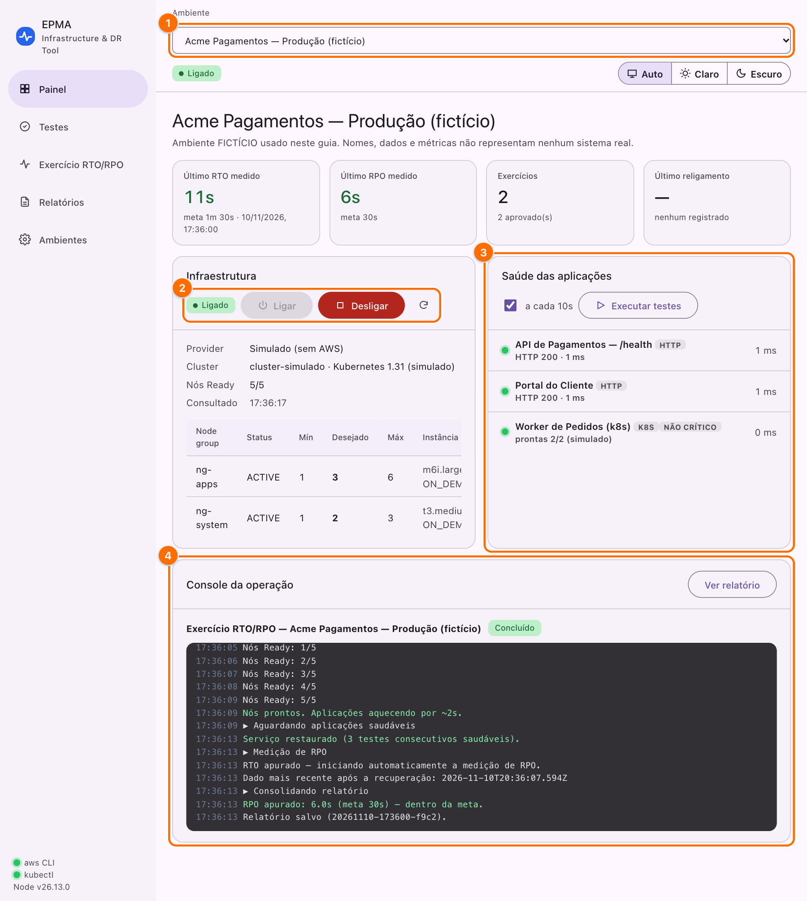

1. **① Seletor de ambiente** (topo): escolhe com qual ambiente você trabalha. Fica travado enquanto há uma operação em andamento.
2. **② Estado e botões Ligar / Desligar**: mostram se o ambiente está *Ligado*, *Desligado*, *Parcial* ou *Em transição*. "Desligar" exige digitar o nome do ambiente (ambientes não simulados).
3. **③ Saúde das aplicações**: resultado dos testes cadastrados (verde = passou). Atualiza a cada 10 s e tem o botão **Executar testes**.
4. **④ Console da operação**: o registro ao vivo de qualquer ligar, desligar ou exercício; depois de um exercício aparece o botão **Ver relatório**.

Os cartões do topo resumem o último **RTO** e **RPO** medidos contra as metas, o total de exercícios e o tempo do último religamento.

> Dica: use **Ligar/Desligar** à mão para conhecer o ambiente. Ligar também registra quanto tempo as aplicações levam para ficar saudáveis.

### Passo 2 — Crie o ambiente pelo wizard

Em **Ambientes → + Novo ambiente** abre um assistente que **descobre os recursos sozinho** (somente leitura) e monta o ambiente.
Se preferir, o link **Configurar manualmente** leva ao formulário completo.

**Etapa Básico** — nome, descrição e a *base de computação*.

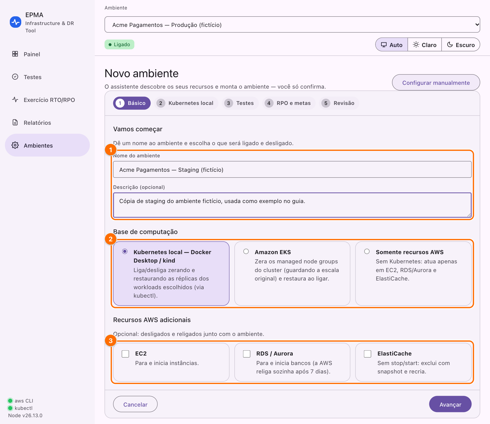

1. **① Nome e descrição** do ambiente.
2. **② Base de computação**: *Kubernetes local — Docker Desktop/kind*, *Amazon EKS* ou *Somente recursos AWS*.
3. **③ Recursos AWS adicionais** (opcional): EC2, RDS/Aurora e ElastiCache, ligados e desligados junto com o ambiente.

As etapas seguintes aparecem conforme a escolha (por exemplo *Conta AWS*, *Cluster EKS*, *EC2*, *RDS*, *ElastiCache*).

**Etapa Kubernetes local** — contexto do `kubectl` e workloads.

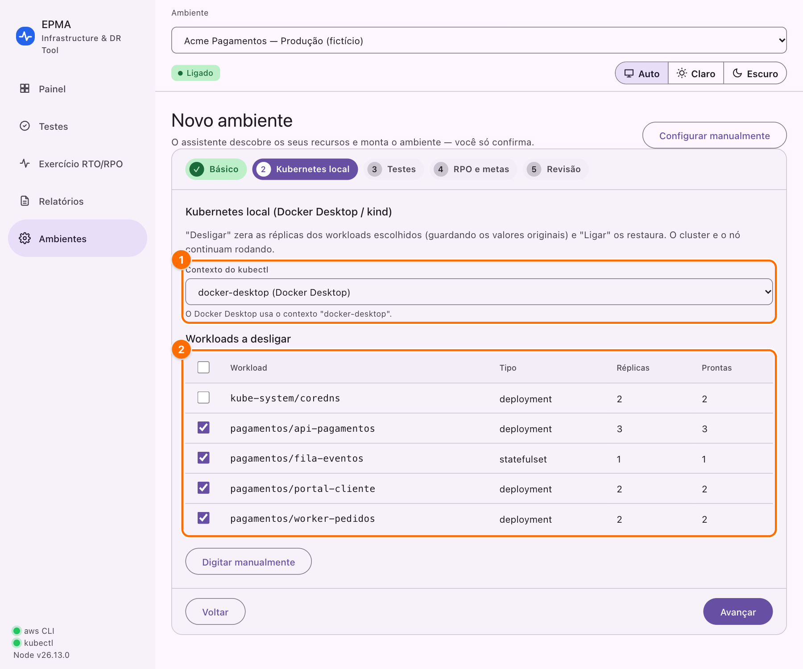

1. **① Contexto do kubectl**: o Docker Desktop é pré-selecionado quando existe.
2. **② Workloads a desligar**: os Deployments e StatefulSets descobertos. "Desligar" zera as réplicas (guardando os valores originais) e "Ligar" as restaura.

> Se a descoberta falhar (credencial expirada, `kubectl` sem acesso), a etapa mostra o erro com **Tentar de novo** e **Digitar manualmente**; o wizard nunca trava.

**Etapa Testes** — sugestões automáticas.

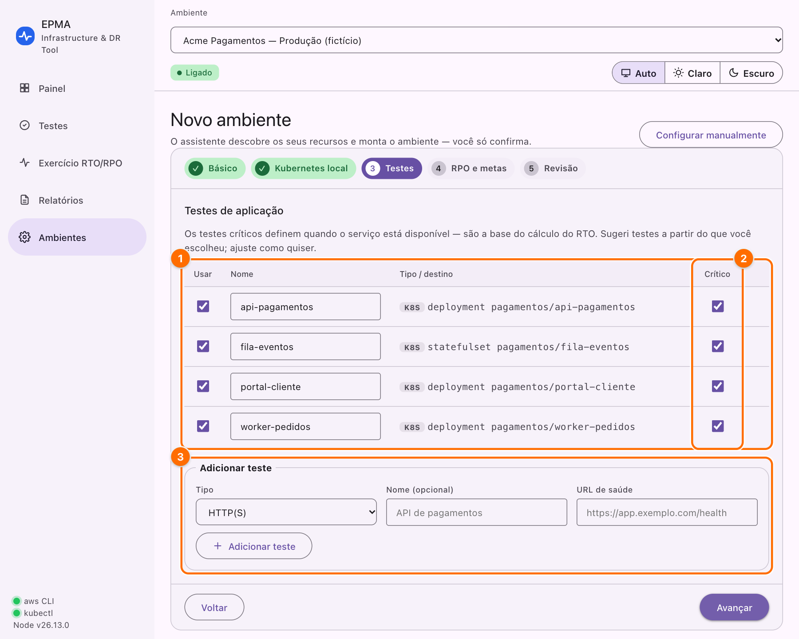

1. **① Sugestões**: um teste `k8s` por workload escolhido (e um TCP por banco RDS com endpoint). Você liga/desliga cada um.
2. **② Crítico**: define se o teste conta para o serviço estar "no ar".
3. **③ URL HTTP de saúde** (opcional): acrescenta um teste HTTP.

É obrigatório ter **ao menos um teste crítico**.

**Etapa RPO e metas**

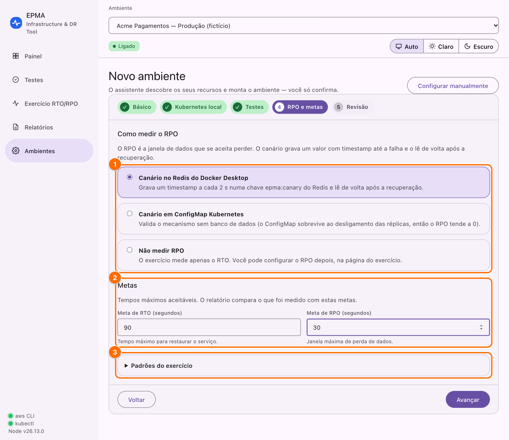

1. **① Método de RPO**: canário no Redis do Docker Desktop, canário em ConfigMap Kubernetes, RDS (*LatestRestorableTime*) ou *Não medir RPO*.
2. **② Metas**: RTO e RPO em segundos (neste guia, 90 s e 30 s).
3. **③ Padrões do exercício** (seção recolhida): acionamento, intervalo entre testes, testes estáveis e limite de recuperação.

**Etapa Revisão**

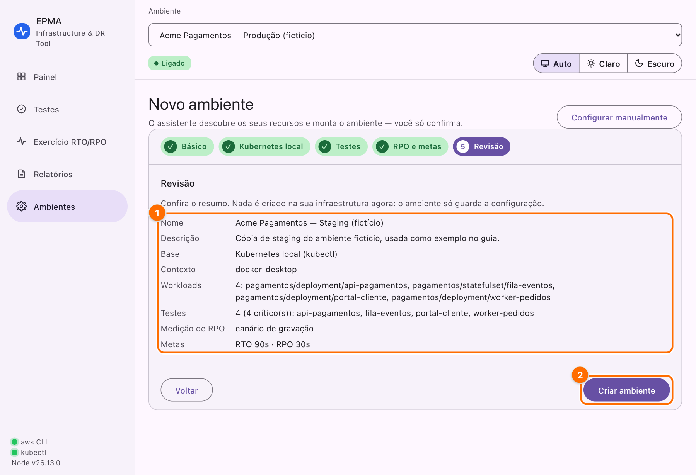

1. **① Resumo** de tudo que será criado.
2. **② Criar ambiente**: salva, seleciona o ambiente e leva ao Painel.

### Passo 3 — Cadastre e execute os testes de aplicação

Os testes dizem ao console **o que significa "o serviço está no ar"**. Abra a página **Testes**.

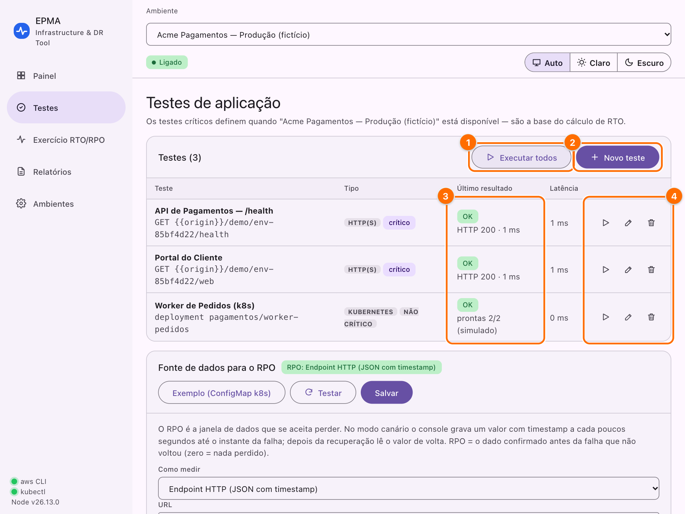

1. **① Executar todos**: roda os testes agora (ou use ▶ em cada linha).
2. **② Novo teste**: abre o formulário.
3. **③ Último resultado**: *OK* ou *Falha*, com o detalhe e a latência.
4. **④ Ações por linha**: executar, editar e excluir.

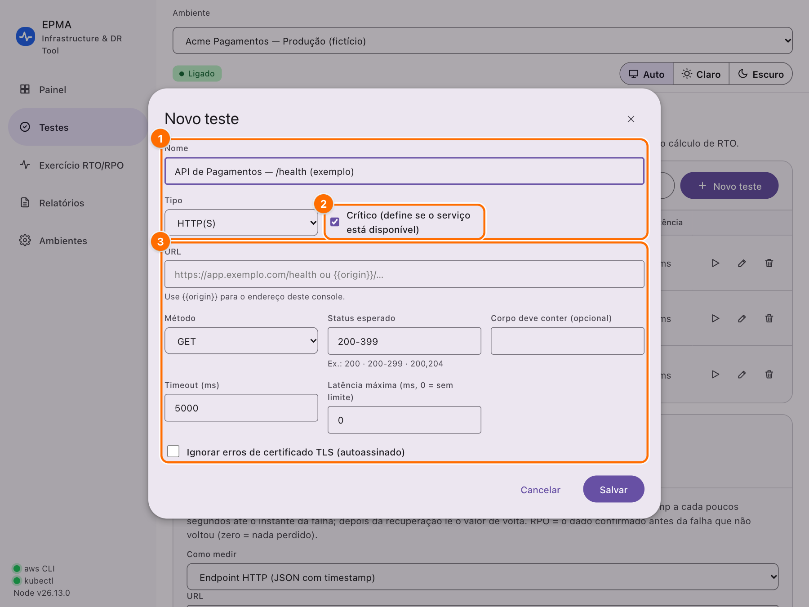

1. **① Nome e tipo** do teste.
2. **② Crítico**: marque se a falha deve contar como indisponibilidade.
3. **③ Campos do tipo escolhido**.

| Tipo | Passa quando… | Campos principais |
|---|---|---|
| **HTTP(S)** | o status é o esperado (padrão `200-399`), o corpo contém o texto (opcional) e a latência está no limite (opcional) | URL, método `GET`/`HEAD`, status esperado, "corpo deve conter", timeout, latência máxima, ignorar TLS autoassinado |
| **Porta TCP** | a conexão abre dentro do timeout | host, porta, timeout |
| **Kubernetes** | todas as réplicas do recurso estão prontas (exige `kubectl`) | tipo (Deployment, StatefulSet, DaemonSet), namespace, nome |
| **Comando** | o código de saída é `0` (executado **sem shell**) | comando, timeout |

**Crítico × não crítico.** O serviço só é considerado "no ar" quando **todos os testes críticos** passam. É isso que
define o RTO. Testes não críticos aparecem no relatório, mas não alongam nem encurtam o RTO. Use crítico para o que o
usuário percebe (API, portal) e não crítico para itens auxiliares.

> No URL é possível usar `{{origin}}` para apontar para o próprio console (útil no ambiente simulado).

### Passo 4 — Configure a medição de RPO

No cartão **Medição de RPO** (página *Exercício RTO/RPO* ou *Testes*) escolha **Como medir**:

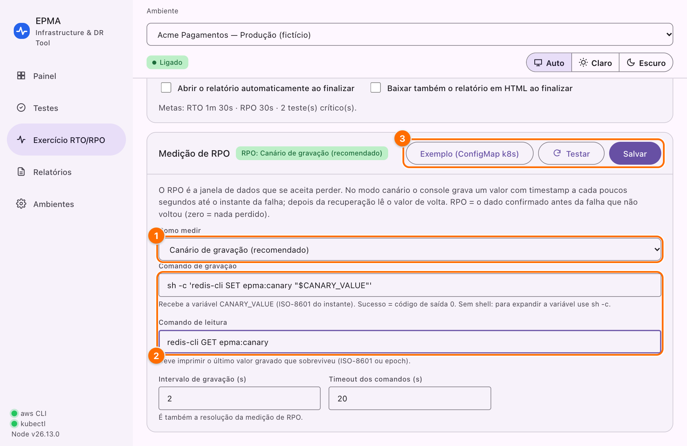

1. **① Como medir**: o método de RPO.
2. **② Comandos de gravação e leitura** (no canário).
3. **③ Exemplo / Testar / Salvar**: preenche um exemplo, valida a gravação e leitura, e salva.

| Método | Como funciona | Quando usar |
|---|---|---|
| **Canário de gravação** *(recomendado)* | o console grava um valor com timestamp a cada poucos segundos até a falha e, depois da recuperação, lê de volta | quando você controla um banco/cache e quer medir perda real |
| **Endpoint HTTP** | lê um JSON com o timestamp do dado durável mais recente (`jsonPath`) | a aplicação já expõe "último registro gravado" |
| **Comando** | a última linha da saída é um timestamp (ISO-8601 ou epoch) | consulta própria (ex.: `max(created_at)`) |
| **RDS / Aurora** | usa `LatestRestorableTime` do PITR | bancos gerenciados |
| **Não medir RPO** | só RTO | quando ainda não há fonte |

**Exemplo de canário com Redis**

```text
Gravação:  sh -c 'redis-cli SET epma:canary "$CANARY_VALUE"'
Leitura:   redis-cli GET epma:canary
Intervalo: 2 s
```

- O console define `CANARY_VALUE` (data/hora ISO-8601 do instante) a cada gravação. Como os comandos rodam **sem shell**, use `sh -c '…'` quando precisar expandir a variável.
- Antes da falha o console exige **3 gravações confirmadas** (aquecimento). Ao injetar a falha, as gravações **param**: o último valor confirmado é o "dado em risco".
- Depois da recuperação ele **lê de volta** e compara. **RPO = 0 s** significa que nada confirmado se perdeu; **RPO = 6 s** significa que as últimas gravações (≈ 6 s) não voltaram.
- A resolução da medição é o **intervalo de gravação**.
- Clique em **Testar** antes do exercício: grava e lê de volta para provar que o caminho funciona.

### Passo 5 — Execute o exercício

Abra **Exercício RTO/RPO**.

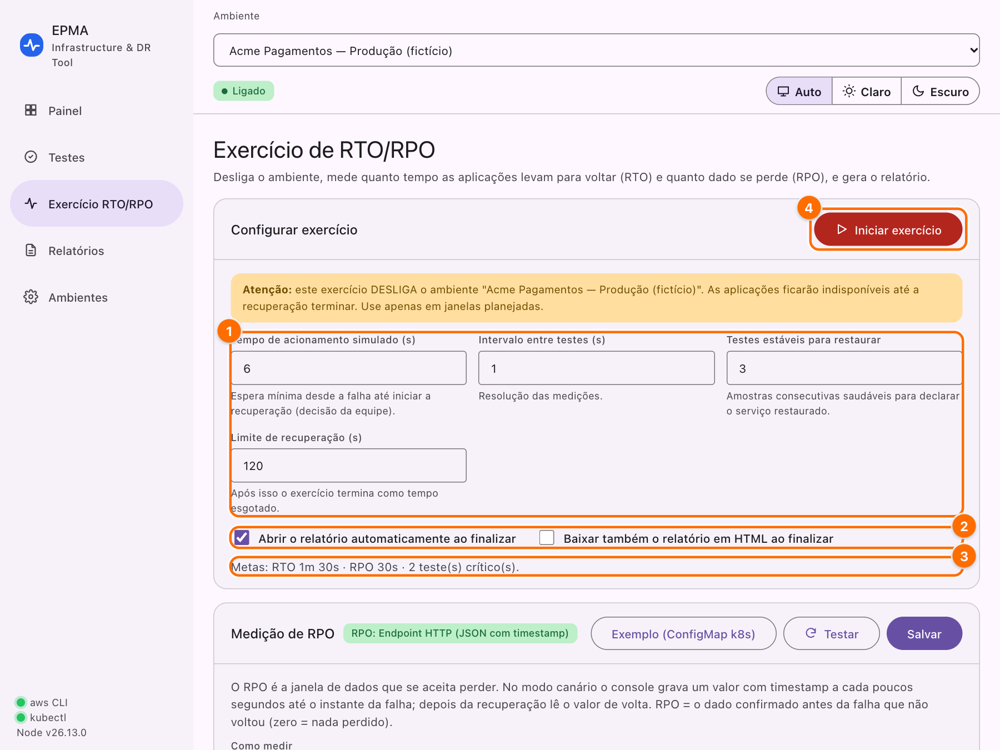

1. **① Parâmetros** do exercício (tabela abaixo).
2. **② Relatório automático**: abrir ao finalizar (padrão) e, opcionalmente, baixar também o HTML.
3. **③ Metas** do ambiente e quantidade de testes críticos.
4. **④ Iniciar exercício**.

| Parâmetro | O que faz | Padrão |
|---|---|---|
| **Tempo de acionamento simulado (s)** | espera mínima entre a falha e o início da recuperação, simulando a decisão da equipe; **conta no RTO** | 30 |
| **Intervalo entre testes (s)** | de quanto em quanto tempo os testes rodam; define a resolução do RTO | 5 |
| **Testes estáveis para restaurar** | quantas amostras saudáveis seguidas declaram o serviço restaurado | 3 |
| **Limite de recuperação (s)** | se o serviço não voltar nesse prazo, o exercício termina como *tempo esgotado* (reprovado) | 1800 |

Ao clicar em **Iniciar exercício**, o console pede confirmação: em ambientes **não simulados** é preciso **digitar o nome do ambiente**.

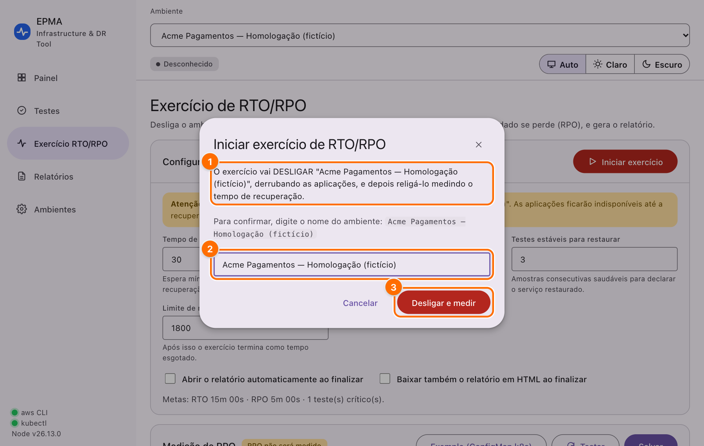

1. **① Aviso**: o exercício vai **desligar** o ambiente e depois religá-lo.
2. **② Campo de confirmação**: digite o nome exato do ambiente.
3. **③ Desligar e medir**: só habilita quando o nome confere.

### Passo 6 — Acompanhe ao vivo

O console executa estas fases (a barra de etapas destaca a atual):

| Etapa | O que acontece |
|---|---|
| **Pré-verificações** | confere se o ambiente está ligado |
| **Linha de base** | roda os testes; todos os críticos precisam passar (e o canário, se houver, aquece) |
| **Falha** | desliga o ambiente; **o relógio do RTO começa** |
| **Acionamento** | espera o tempo de acionamento simulado |
| **Recuperação** | religa o ambiente |
| **Validação** | aguarda os testes críticos ficarem estáveis; **o RTO é apurado** |
| **Medição de RPO** | começa **sozinha** logo após o RTO: lê o dado de volta e confirma que a escrita voltou |
| **Relatório** | consolida, salva e abre o relatório |

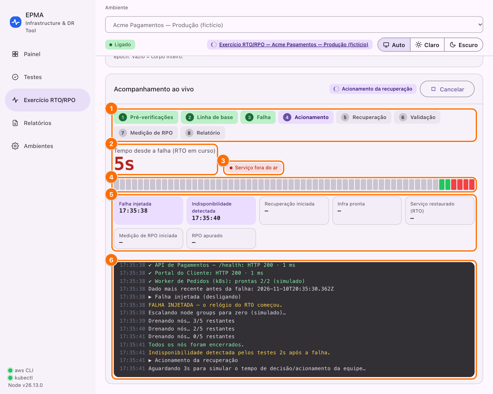

1. **① Barra de etapas**: a fase atual está destacada.
2. **② Tempo desde a falha**: o RTO em curso, em vermelho enquanto o serviço está fora.
3. **③ Serviço fora do ar**: situação atual segundo os testes críticos.
4. **④ Faixa de amostras**: cada quadrado é uma rodada de testes (verde = saudável, vermelho = falhou).
5. **⑤ Marcos**: falha injetada, indisponibilidade detectada, recuperação iniciada, infra pronta, serviço restaurado, início e fim da medição de RPO.
6. **⑥ Console**: o registro do exercício.

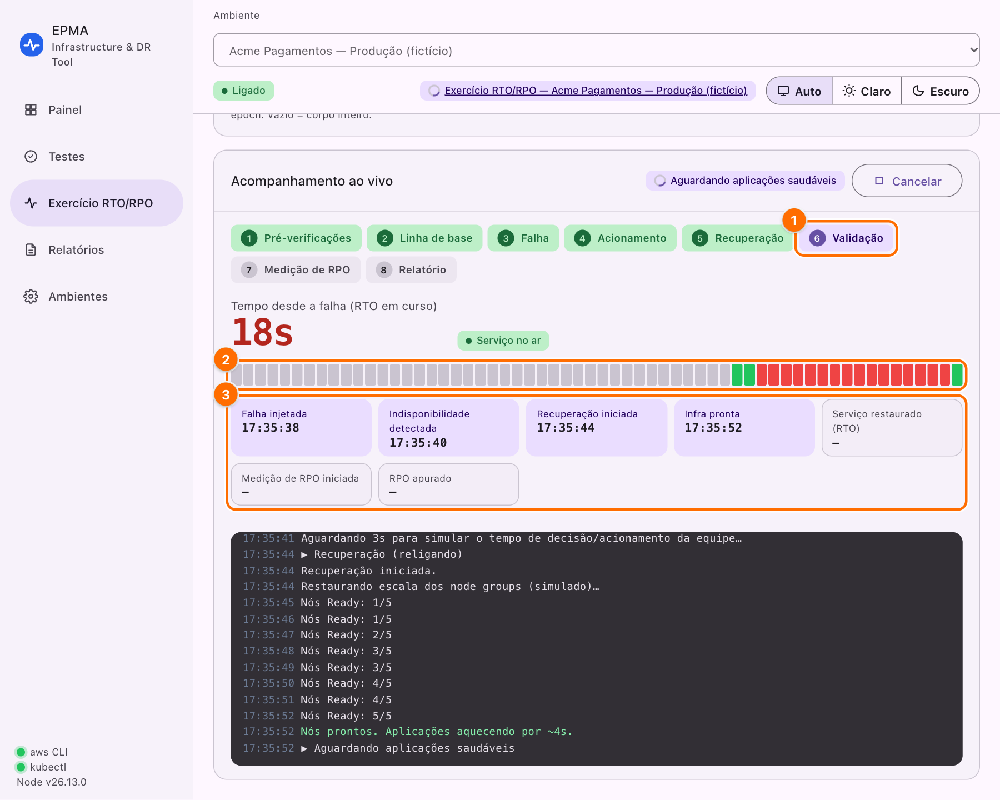

1. **① Fase atual** (*Recuperação* → *Validação*).
2. **② Faixa de amostras**: o verde volta; o RTO é congelado quando a sequência estável se completa.
3. **③ Marcos** já preenchidos com os horários.

Ao terminar aparece o resultado:

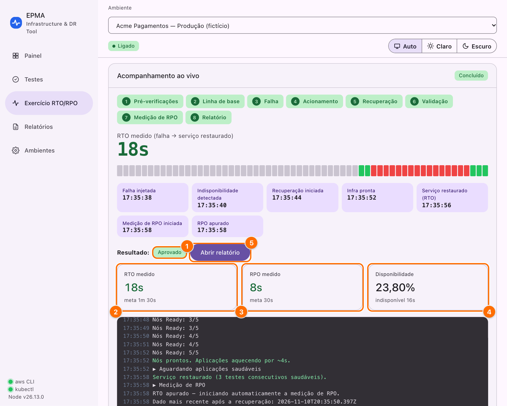

1. **① Veredito** (Aprovado, Reprovado ou Incompleto).
2. **② RTO medido** contra a meta.
3. **③ RPO medido** contra a meta (ou "não medido").
4. **④ Disponibilidade** observada na janela do exercício.
5. **⑤ Abrir relatório**: se a opção estiver marcada, o relatório já abre sozinho.

Você pode **Cancelar** durante o exercício: se a falha já tinha sido injetada, o console executa uma **recuperação de segurança** para não deixar o ambiente desligado.

### Passo 7 — Leia e exporte o relatório

Ao finalizar, o console abre a página **Relatórios** com a execução selecionada.

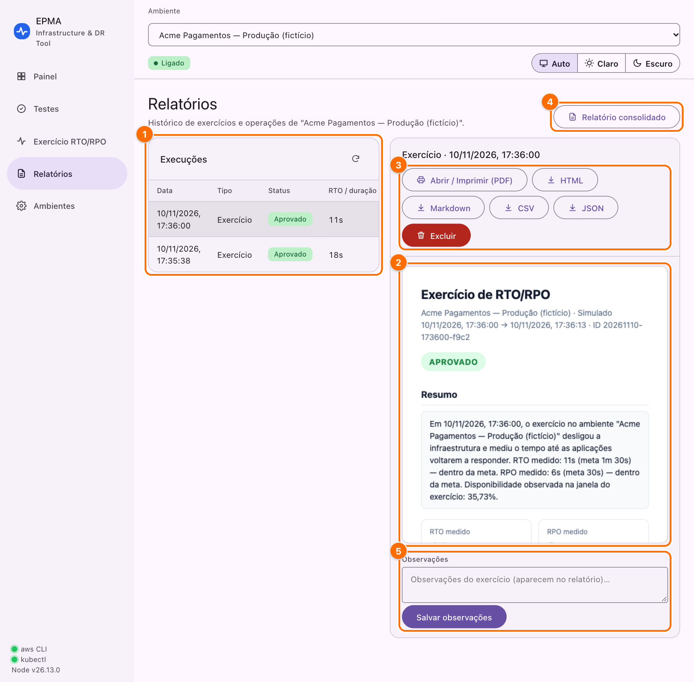

1. **① Lista de execuções** do ambiente (data, tipo, veredito, RTO, RPO).
2. **② Prévia** do relatório selecionado.
3. **③ Exportação**: **Abrir / Imprimir (PDF)**, **HTML**, **Markdown**, **CSV** (amostras, só para exercícios) e **JSON**.
4. **④ Relatório consolidado**: visão de todos os exercícios do ambiente.
5. **⑤ Observações**: campo de notas que entra no relatório.

**O que cada seção do relatório mostra**

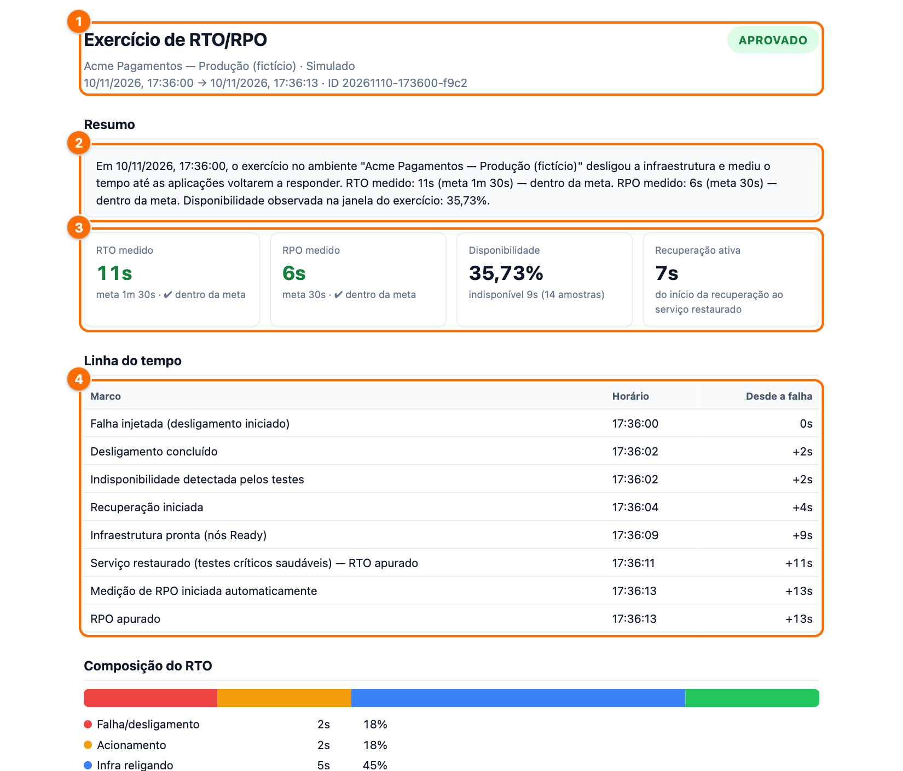

1. **① Cabeçalho**: ambiente, provedor, período, ID e o **veredito**.
2. **② Resumo**: o resultado em um parágrafo.
3. **③ Cartões**: RTO e RPO medidos contra as metas, disponibilidade e recuperação ativa.
4. **④ Linha do tempo**: cada marco com o horário e o tempo desde a falha.

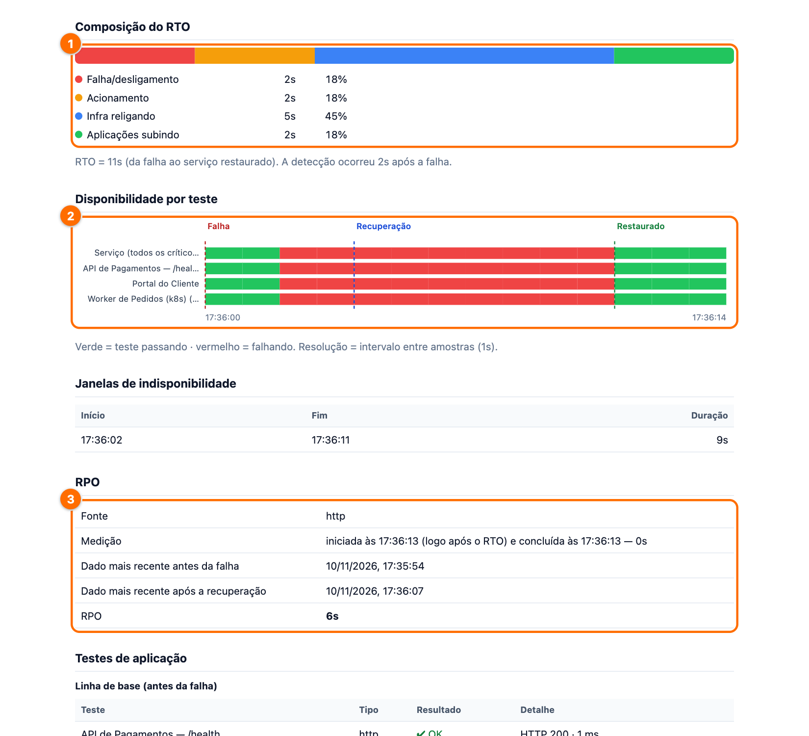

1. **① Composição do RTO**: quanto veio de desligamento, acionamento, infraestrutura religando e aplicações subindo.
2. **② Disponibilidade por teste**: uma faixa por teste, com os marcos de falha, recuperação e restauração.
3. **③ RPO**: fonte, horário da medição, dado antes da falha, dado depois da recuperação e (no canário) gravações confirmadas.

Mais abaixo: *Janelas de indisponibilidade*, *Testes de aplicação* (linha de base e validação final), *Parâmetros e método*,
**Recomendações** automáticas, *Observações* e o *Registro de eventos*.

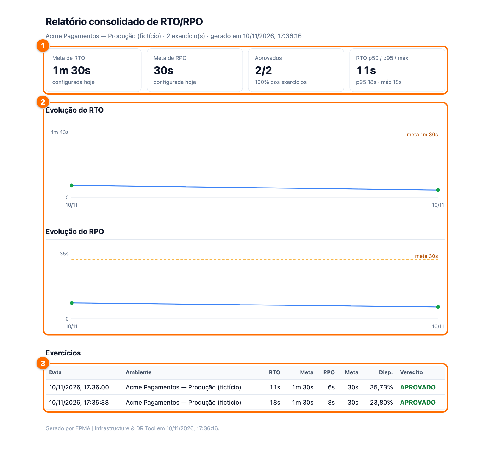

1. **① Indicadores**: metas, exercícios aprovados e percentis do RTO.
2. **② Evolução do RTO e do RPO** exercício a exercício, com a linha da meta.
3. **③ Tabela de exercícios** com veredito.

O consolidado serve para mostrar a **tendência** ao longo do tempo (as metas estão sendo atendidas? melhorou depois de uma mudança?).

> Dica: o modo **Escuro** (e **Auto**, que segue o sistema) fica no canto superior direito. Os relatórios exportados continuam claros, próprios para impressão.
>
> 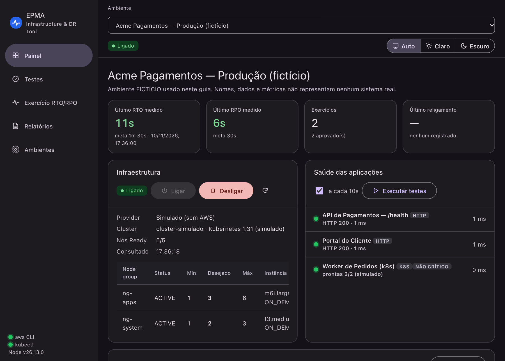

---

## 4. Como interpretar os resultados

| Veredito | Significa | O que fazer |
|---|---|---|
| **Aprovado** | RTO ≤ meta e, se medido, RPO ≤ meta | repita periodicamente e após mudanças de arquitetura |
| **Reprovado** | RTO ou RPO acima da meta, ou o serviço não voltou no limite | veja a **composição do RTO** e as **Recomendações** do relatório |
| **Incompleto** | foi cancelado ou deu erro antes de concluir | leia o registro de eventos; confirme que o ambiente voltou a ligar |

**Onde está o gargalo?** Olhe a composição do RTO:

| Parcela grande em… | Provável causa | Caminho |
|---|---|---|
| **Acionamento** | decisão e execução manuais | automatizar o runbook; alarmes que disparam a recuperação |
| **Infra religando** | nós, bancos ou caches demorando | capacidade mínima/warm pool, imagens em cache, Karpenter (EKS) |
| **Aplicações subindo** | readiness, init containers, migrações no boot | revisar probes, tamanho das imagens e dependências |
| **Detecção** (marco) | alarmes/health checks lentos | revisar intervalos, limiares e canais de aviso |

**RPO acima da meta?** Reduza a janela de perda: backups/snapshots mais frequentes, PITR habilitado, replicação com menor
atraso ou fila durável antes do armazenamento.

**Uma medição vale pelo que ela alcança.** A resolução é o intervalo entre testes (RTO) ou entre gravações (canário). Para
metas muito curtas, diminua esses intervalos.

---

## 5. Boas práticas e segurança

- **Comece pelo simulado** para treinar o fluxo e depois por um ambiente de **não produção**.
- Em produção, faça em **janela planejada**, com a equipe avisada: o exercício **derruba** o ambiente de verdade.
- Garanta uma **linha de base saudável** antes de começar; o exercício só vale partindo de um ambiente saudável.
- Mantenha ao menos **um teste crítico** que represente a experiência do usuário.
- **Acesso:** por padrão o console escuta só em `localhost`. Para expor fora disso é obrigatório um `ADMIN_TOKEN` (≥ 16 caracteres). Operações destrutivas exigem digitar o nome do ambiente.
- **Credenciais:** o console usa o `aws` CLI e o `kubectl` da sua máquina; não guarda senhas. Prefira perfis/SSO, role ou variáveis `AWS_*`.
- **ElastiCache não tem stop/start:** desligar **exclui** o recurso com snapshot final e ligar o **recria** (o endpoint pode mudar). É preciso marcar o aceite na configuração; os snapshots ficam retidos e geram custo.
- **RDS** é religado sozinho pela AWS após 7 dias parado.
- Se algo falhar depois da falha injetada, o console tenta a **recuperação de segurança**. Mesmo assim, **confira o ambiente** ao final.

---

## 6. Solução de problemas

| Sintoma | Causa provável | O que fazer |
|---|---|---|
| *"A linha de base tem testes críticos falhando"* | o ambiente já não estava saudável | corrija o teste/ambiente; rode **Executar testes** até ficar tudo verde |
| *"O ambiente precisa estar ligado para iniciar o exercício"* | estado diferente de *Ligado* | use **Ligar** e confirme o estado no Painel |
| *"Cadastre ao menos um teste…"* / *"Marque ao menos um teste como crítico"* | faltam testes ou nenhum é crítico | cadastre/marque na página **Testes** |
| **RPO "não medido"** | sem fonte de RPO, leitura falhou ou o canário não gravou | configure o cartão **Medição de RPO** e use **Testar**; veja os *Avisos* do relatório |
| *"O canário não conseguiu gravar…"* | comando de gravação com erro | rode o comando à mão; lembre do `sh -c` para usar `$CANARY_VALUE` |
| Erro de credencial AWS (*NoCredentials*, token expirado) | sessão SSO expirada ou perfil errado | `aws sso login --profile SEU_PERFIL`; confira perfil e região no wizard |
| `kubectl` sem acesso / contexto inexistente | kubeconfig ou contexto errado | `kubectl config get-contexts`; escolha o contexto correto; no container, monte o kubeconfig |
| Aviso: *"Os testes não detectaram indisponibilidade"* | os testes não são sensíveis à falha (ex.: checam algo que continua no ar) | use testes que dependam do que foi desligado; o RTO pode estar subestimado |
| Exercício terminou como *tempo esgotado* | o serviço não voltou dentro do limite | veja o registro de eventos; aumente o limite se o tempo é legítimo |
| Container recusa subir | falta `ADMIN_TOKEN` ao escutar em `0.0.0.0` | defina `ADMIN_TOKEN` ou `ADMIN_TOKEN_FILE` |

Ainda sem solução? O **Registro de eventos** do relatório (e o *Console da operação*) mostra cada passo com horário.

---

## 7. Regenerar as imagens e o vídeo

As imagens de `docs/img/` e o vídeo `docs/video/demo-60s.mp4` são gerados por um script que controla um navegador de
verdade contra uma **instância isolada com dados fictícios**:

```bash
docs/tools/run-capture.sh
```

O script:

1. sobe o console em outra porta e em um diretório de dados temporário, sem tocar nos seus ambientes e relatórios;
2. cria o ambiente fictício "Acme Pagamentos — Produção (fictício)" (simulado, metas RTO 90 s / RPO 30 s) e usa `kubectl`/`docker` de mentira no wizard;
3. percorre o fluxo deste guia, tira as capturas com marcadores numerados e grava o vídeo de 60 s;
4. encerra a instância e apaga os dados temporários.

Requisitos: **Google Chrome** e **ffmpeg** instalados.
